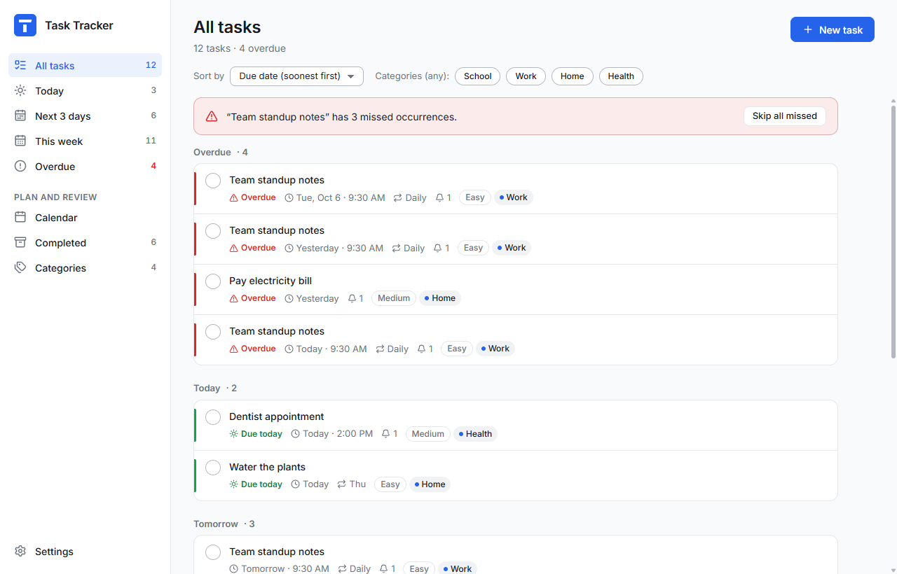
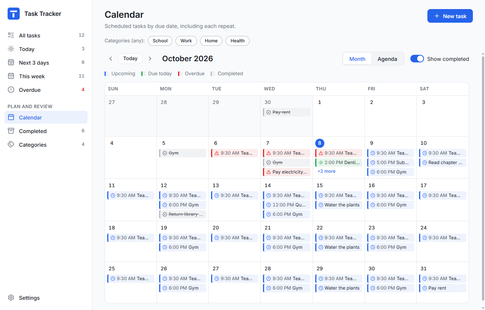
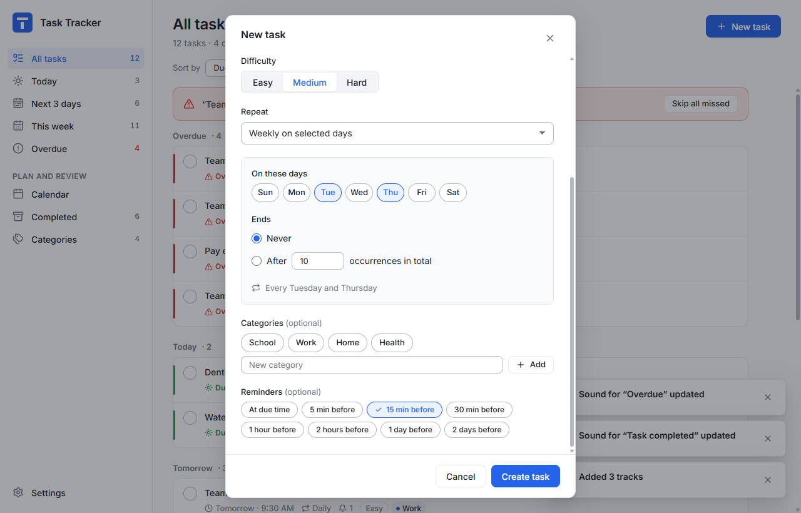

# Task Tracker

A desktop task tracker for Windows, built with Electron. It covers one-time and repeating tasks, categories, reminders through Windows notifications, a calendar, and a 90-day history of completed work.

| Calendar                              | Task editor                            |
| ------------------------------------- | -------------------------------------- |
|  |  |

## Features

- **Tasks** with a name, due date and optional time, difficulty (Easy / Medium / Hard), categories and reminders.
- **Repeats** daily, on selected weekdays, or monthly (the 29th–31st fall back to the last day of shorter months). A repeat can run forever or for a set number of times.
- **Views**: All tasks, Today, Next 3 days, This week, Overdue, Calendar (month or agenda), and Completed. Each view can be sorted by due date or difficulty and filtered by category.
- **Repeating tasks** can be edited or deleted for one occurrence, or for that occurrence and the ones after it. Missed occurrences stay overdue until you complete or skip them; "Skip all missed" clears a backlog.
- **Completion history** records when each task was done and whether that was early, on time or late. Records are kept for 90 days, and completing a task can be undone.
- **Reminders** arrive as Windows notifications, together with a short glowing edge around the window. They keep working while the app sits in the system tray. Anything missed while the app was closed is summed up in one notice.
- **Sounds**: choose your own file for each kind of notification and each action, and add a playlist of background music. All of this is in Settings › Sound.
- **Data** is saved in one file in `%APPDATA%\tasktracker`, written safely and backed up. Tasks saved by the earlier version of the app are imported automatically the first time.

## Requirements

- Windows 10 or 11 (the app is built and tested on Windows).
- [Node.js](https://nodejs.org/) 22.12 or newer, or 24.
- Run `npm install` once after cloning.

## Running

| Command                | What it does                                                                                                                   |
| ---------------------- | ------------------------------------------------------------------------------------------------------------------------------ |
| `npm run dev`          | Starts the app with live reload while you edit the code.                                                                       |
| `npm run build`        | Type-checks, builds the app and creates the Windows installer at `release/<version>/Task-Tracker-Windows-<version>-Setup.exe`. |
| `npm run electron:dev` | Runs the last build without the dev server.                                                                                    |
| `npm run icons`        | Regenerates the icon files from the SVG logo in `src/assets/brand`.                                                            |

The installer is not code-signed, so Windows SmartScreen will warn that the publisher is unknown when it first runs. Signing requires a code-signing certificate.

## Checks and tests

| Command                           | What it does                                                                                                                                 |
| --------------------------------- | -------------------------------------------------------------------------------------------------------------------------------------------- |
| `npm run check`                   | Type check, lint and all unit and integration tests.                                                                                         |
| `npm test`                        | Unit and integration tests (Vitest), run in US Pacific time so daylight saving is covered.                                                   |
| `npm run test:e2e`                | Builds the app, then drives the real app through its main journeys (Playwright). Each test uses a throwaway data folder.                     |
| `npm run test:manual`             | Checks on real Windows and packaged builds: a real notification, the packaged app, and the fuses that lock the installed program. See below. |
| `npm run lint` / `npm run format` | ESLint / Prettier.                                                                                                                           |

The end-to-end tests also save screenshots of every screen to `test-results/screens/` for visual review.

**Before `npm run test:manual`**, run both `npm run build` (the real, locked-down build, used by the fuse checks) and `npm run build:inspectable`. The second command builds a test copy in `release/inspectable/` that only differs by allowing the debugger the packaged-app check needs. Never ship that copy. To check the import of data saved by the old version, copy `%APPDATA%\tasktracker\Local Storage` into an empty folder, serve the interface on `localhost:5173`, and run the check with `LEGACY_PROFILE` set to that folder. Instructions are at the top of `tests/manual/legacy-import.spec.ts`.

## Where things live

| Path                          | Contents                                                                                                                                                               |
| ----------------------------- | ---------------------------------------------------------------------------------------------------------------------------------------------------------------------- |
| `src/domain/`                 | The core rules: dates, repeats, occurrences, statuses, commands, the archive, reminders and validation. Plain TypeScript with no UI, shared by both halves of the app. |
| `electron/`                   | The background (main) process: window and tray, saving data, the reminder scheduler, notifications, sound files, and the narrow messaging interface with the window.   |
| `src/renderer/`               | The interface: screens, components, sound playback.                                                                                                                    |
| `src/styles/`                 | Design tokens (colours, spacing, motion) and styles.                                                                                                                   |
| `src/assets/`                 | The logo, and optional built-in sounds (see `src/assets/audio/README.md`).                                                                                             |
| `tests/`                      | Unit, integration, end-to-end and manual tests.                                                                                                                        |
| `docs/specs/`                 | The design and feature specifications this app was built to.                                                                                                           |
| `docs/DECISIONS.md`           | Product decisions made along the way (e.g. how repeat counts and the "Next 3 days" range work).                                                                        |
| `docs/VERIFICATION_MATRIX.md` | How each requirement was verified.                                                                                                                                     |

### Your data

Everything is stored in `%APPDATA%\tasktracker`:

- `task-tracker-data.json` holds tasks, categories, completion history and settings.
- `task-tracker-data.json.bak` is a backup, refreshed at startup and every hour.
- `sounds\` holds the sound files you chose in Settings.

If the data file can't be read, the app restores the backup and keeps the unreadable file under a new name. It never overwrites or deletes it. Settings › Your data › Open folder takes you there.
