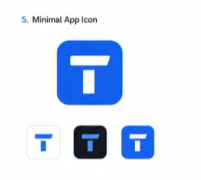

# Task Tracker — Visual Design & Front-End Implementation Specification
**Audience:** Claude Code  
**Purpose:** Treat this document as the source of truth for visual design, interaction design, motion, branding, and notification presentation. Implement the design in the existing project rather than rebuilding the app unnecessarily.

---

## 1. Brand direction

Task Tracker is a polished, focused desktop productivity app. It should feel dependable, organized, fast, and modern—not playful, over-decorated, or like a generic admin dashboard.

**Core design principles**
- Clarity first: users should quickly see what is due, what is urgent, and what they can do next.
- Restrained use of color: blue represents the brand and normal actions; status colors are reserved for task state.
- Consistent components: buttons, fields, cards, chips, dialogs, calendar items, empty states, and notifications must share the same visual language.
- Motion should communicate state and hierarchy, not distract.
- Support keyboard navigation, reduced-motion preferences, readable contrast, and compact desktop layouts.

Do not change the product's existing architecture or replace working functionality just to achieve the visual design. Inspect the repository first, identify its framework and current patterns, and integrate with them. Reuse existing components when appropriate.

## 2. Logo reference — use as the visual source of truth

The selected concept is **Minimal App Icon — concept 5**:
- A saturated blue rounded-square app tile.
- A bold white geometric `T` mark inside it.
- The top bar of the T is wide and horizontal, with subtly angled/tapered ends.
- The vertical stem is centered, rectangular, and separated from the top bar by a small gap.
- The mark is flat, simple, high-contrast, and recognizable at small sizes.
- No text inside the icon, no checkmark, no extra shapes, no gradients, no shadows, and no decorative border.

### Logo geometry and usage
Use the reference image as guidance; recreate the mark cleanly as a vector (prefer SVG) rather than cropping the screenshot into the application. Keep the symbol's proportions consistent: rounded-square tile, centered white T, generous internal padding, thick strokes/shapes, and optical balance.

Create or maintain these brand assets if the project supports them:
- `task-tracker-mark.svg` — scalable blue tile with white T.
- `task-tracker-mark-mono.svg` — white T on charcoal tile, if needed for dark surfaces.
- App/window icon assets in the platform-appropriate sizes and formats required by the existing build setup.
- A wordmark lockup for places where the app name is useful: symbol plus the text **Task Tracker**. The wordmark must not be forced into tiny app-icon contexts.

Do not redraw the T as a text character if a custom vector shape can preserve the reference proportions. Do not stretch the logo, change the T's geometry between screens, or add a circle around it.

## 3. Exact color system

Use these exact hex values as design tokens. Do not introduce unrelated brand colors.

| Token | Hex | Purpose |
|---|---|---|
| `brand-blue` | `#2563EB` | Primary brand, primary actions, selected navigation, future task accents |
| `brand-blue-hover` | `#1D4ED8` | Hover/pressed primary controls; a darker interaction state, not a new brand color |
| `brand-blue-bright` | `#3B82F6` | Limited secondary blue accent, focus highlights, subtle motion accents |
| `charcoal` | `#171A21` | Main dark surfaces, dark theme base, high-emphasis text on light backgrounds |
| `white` | `#FFFFFF` | Main light surfaces, text/icons on blue or charcoal |
| `soft-gray` | `#E5E7EB` | Light borders, dividers, disabled fills where contrast remains adequate |
| `muted-gray` | `#6B7280` | Secondary text on light backgrounds; verify contrast before use |
| `surface-light` | `#F8FAFC` | Optional light-theme app canvas/surface, if a near-white surface is needed |

**Status colors are semantic exceptions, not extra brand colors:**
- Overdue / late: `#DC2626` (red).
- Due today and not yet overdue: `#16A34A` (green).
- Future tasks: `#2563EB` (brand blue).
- Reminder edge flash: `#3B82F6` (bright blue).
- Success confirmation: use green sparingly; do not recolor the whole interface.

Use red and green only where task state requires them, especially calendar items and late feedback. Do not use status color as decoration.

### Suggested light theme
- Main background: `#F8FAFC`.
- Primary content surfaces/cards: `#FFFFFF`.
- Main text: `#171A21`.
- Secondary text: `#6B7280`.
- Borders/dividers: `#E5E7EB`.
- Primary button: `#2563EB` with white text.
- Selected navigation: pale blue-tinted background derived from the brand blue at low opacity, with blue icon/text.
- Focus ring: visible `#3B82F6` outline with adequate offset.

### Suggested dark theme
- Main background: `#171A21`.
- Elevated panels: a slightly lighter charcoal surface (for example `#20242D`); keep this within the charcoal family.
- Main text: `#FFFFFF`.
- Secondary text: `#D1D5DB`.
- Borders/dividers: subtle charcoal-gray separation; avoid bright borders around every card.
- Primary button: `#2563EB` with white text.
- Selected navigation: restrained blue-tinted surface with a clear blue indicator.
- Keep the logo's blue tile and white T intact.

If the app currently has only one theme, implement that theme well first; do not add a theme toggle unless it fits the existing scope. If light and dark themes are supported, use tokens so both remain consistent.

## 4. Logo placement throughout the app

### App shell / navigation
- Put a small version of the blue rounded-square T icon at the top of the sidebar or app navigation.
- Pair it with the **Task Tracker** wordmark in the expanded sidebar/header.
- If the sidebar can collapse, show only the icon and provide an accessible tooltip/label.
- Keep the logo modest: it should establish identity without competing with the task list.
- Use the same icon in the window/app identity and installer assets where supported by the existing desktop packaging.

### Loading and empty states
- Use a small logo mark on the initial loading/splash state, not a large marketing logo.
- In a genuinely empty task list, show a simple empty-state illustration or the T icon plus a useful message and a primary “Create task” action. Avoid repetitive oversized branding on every screen.
- When there are no search/filter results, explain how to clear the filter rather than showing the first-run empty state.

### Task-related surfaces
- Do not place the full logo on every task row. Use the blue brand for primary actions and selected states; use small status indicators for urgency.
- Use the icon in About, Help, and settings pages only where it helps identify the app.
- Use a simplified monochrome mark only when necessary for high-contrast contexts; the default app icon remains blue tile + white T.

## 5. Layout and component language

### Overall structure
Use a calm desktop layout with:
1. **Sidebar/navigation:** Overview or All Tasks, Today, Next 3 Days, This Week, Overdue, Calendar, Completed/Archive, and Categories.
2. **Main content area:** clear page title, concise summary, view controls, filters/sorting, then task content.
3. **Primary action:** a consistently placed “New task” button in brand blue.
4. **Optional details panel/modal:** task creation and editing should be focused, easy to scan, and not visually crowded.

Adapt these to the current project rather than duplicating navigation items or inventing unnecessary sections.

### Cards and lists
- Use white/light cards on the light canvas and charcoal-family cards on dark canvas.
- Use subtle borders and restrained corner rounding. Avoid heavy shadows, glowing borders, glassmorphism everywhere, and excessive nested cards.
- Each task row should make the title the strongest element, with due date/time, difficulty, recurrence, and categories secondary.
- Use compact chips for categories and difficulty; chips should not overwhelm the task title.
- Provide distinct hover, keyboard-focus, selected, completed, overdue, and disabled states.
- Avoid communicating status by color alone: include text, iconography, or accessible labels.

### Buttons and controls
- Primary: `#2563EB` background, white text, clear hover/pressed/disabled states.
- Secondary: neutral surface with charcoal text and a soft-gray border.
- Destructive: red text/indicator, with a confirmation step for destructive actions.
- Inputs: consistent height, spacing, label placement, focus ring, validation messages, and keyboard behavior.
- Use icons consistently (prefer a single icon family such as Lucide); do not mix unrelated icon styles.

### Typography and spacing
- Use a modern sans-serif such as Inter or the project's existing readable UI font.
- Keep headings clear but not oversized. Use consistent type scale and line-height.
- Use a spacing scale (for example 4, 8, 12, 16, 24, 32 px) rather than arbitrary gaps.
- Ensure dense task lists remain scannable and useful at common laptop window sizes.

## 6. Feature-specific visual behavior

### Task creation and editing
The form must support:
- Task name (required).
- Due date and time.
- Difficulty level.
- Frequency/recurrence: one-time, daily, selected days per week, weekly, monthly, and other recurrence options supported by the data model.
- Repetition count or end condition.
- Multiple categories.
- Reminder configuration, including no reminder.
- Editing all existing task properties.

Use progressive disclosure for recurrence and reminder details: show basic fields first and reveal advanced options when selected. Make recurrence language human-readable (for example, “Every Monday and Thursday”). Validate required fields inline, preserve form input after recoverable errors, and clearly distinguish Save, Cancel, and Delete.

### Categories
- Allow users to add categories.
- Render categories as restrained colored/text chips, but keep the main brand blue as the common accent.
- Do not assign arbitrary new colors that break the brand. If category colors are configurable, offer a controlled, accessible palette and ensure text contrast.
- Deleting a category must not delete the tasks assigned to it. Explain that tasks remain and remove only the category association.

### Task views, filters, and sorting
Provide views for:
- All tasks.
- Today.
- Next 3 days.
- This week.
- Overdue.
- Completed/archive.
- Calendar.

Support sorting by due date and difficulty, and filtering/grouping by category. Clearly show active filters and provide a one-action way to clear them. Switching views should feel immediate and preserve relevant context when reasonable.

### Completion and archive
- Completing a task should remove it from active task lists and move it to the archive.
- Use a quick, subtle completion animation: checkbox fills, a checkmark draws/fades in, and the row fades/slides out slightly before the list closes the gap.
- Avoid making completion animation block interaction.
- Archive records must retain original task information plus completion timestamp and whether completion was early, on time, or overdue.
- Archived tasks are retained for approximately 90 days, then removed according to the app's retention logic. Make the retention behavior clear in the archive UI or settings if appropriate; do not silently delete active tasks.
- Provide Undo immediately after accidental completion when feasible.

### Calendar
- Calendar task items use semantic colors:
  - Future tasks: blue `#2563EB`.
  - Due today and not overdue: green `#16A34A`.
  - Overdue tasks: red `#DC2626`, displayed on their original due date as specified.
- If a task due today passes its due time, update it to overdue/red based on the app's time logic.
- Include a legend with text labels, not color dots alone.
- Keep event text readable; use a compact indicator or count when many tasks share a date.
- Provide a task detail popover/panel on selection and retain an accessible list-based alternative to the calendar.

## 7. Motion and animation specification

Use motion to communicate state. Keep animation short, purposeful, and consistent. Prefer CSS transitions or the project's existing animation library. If using a library, use a lightweight, well-supported option such as Motion (formerly Framer Motion, if the project uses React) or CSS for simple transitions. Do not add a large dependency solely for a small fade.

### App launch / opening sequence
Implement a restrained opening sequence:
1. **Window appears:** use the platform's normal window launch behavior; do not delay the app artificially.
2. **Logo entrance:** on first paint, show the app mark at approximately 88–104 px in a centered loading area only if initialization genuinely requires a loading state.
3. **Mark motion:** animate from 96% scale to 100% scale with a gentle ease-out over roughly 180–240 ms; fade opacity from 0 to 1 over roughly 160–220 ms. No bouncing, spinning, elastic overshoot, or 3D rotation.
4. **Optional brand accent:** a thin blue line can briefly grow from left to right beneath the mark over 220–300 ms. It should not resemble a fake progress bar if loading progress is unknown.
5. **Reveal the app:** fade/translate the main interface in by 4–8 px over 160–220 ms, beginning once the app is ready. Avoid a long splash screen; if startup is fast, skip the splash and reveal the app immediately.
6. **Subsequent launches:** do not replay a long branded intro every time. Keep startup fast; use the full logo sequence only when a real loading state exists or on first-run onboarding.

### Normal interactions
- Hover/focus: 100–160 ms color/border transitions.
- Menus/popovers: fade + 4 px vertical movement, about 120–180 ms.
- Modal/dialog: fade in with a 4–8 px rise, about 160–200 ms; backdrop appears subtly.
- Task completion: checkbox state transition around 120–180 ms; row exit around 160–220 ms.
- Filter/view change: subtle content fade around 100–160 ms; avoid animating every row independently if it causes visual noise.
- Calendar navigation: short crossfade or horizontal transition under 200 ms; preserve user orientation.
- Toasts: enter/exit quickly with a short fade/slide; remain readable and dismissible.
- Do not animate continuously when nothing is happening.

### Edge-of-screen feedback for reminders and overdue tasks
The user requested a subtle flashing line around the edges of the application:
- **Reminder:** use a 2–3 px `#3B82F6` inset outline around the app content/window, pulsing softly twice over approximately 1.2 seconds.
- **Overdue alert:** use a 2–3 px `#DC2626` inset outline, pulsing softly twice over approximately 1.2 seconds.
- Keep the interior layout still. Do not flash the entire screen, rapidly blink, or use strobing effects.
- Do not rely on the edge effect as the only alert; also show a readable in-app toast or status and use the configured OS notification.
- Avoid repeatedly replaying the edge animation for the same overdue task. Deduplicate events and provide a way to dismiss/snooze where the reminder design supports it.
- Stop animation when the user dismisses it. Honor the system `prefers-reduced-motion` setting by replacing the pulse with a static outline or small status indicator.
- Never use red for an ordinary reminder; reserve red for overdue/late status.

### Reduced motion and accessibility
- Respect `prefers-reduced-motion: reduce`.
- In reduced-motion mode, remove scale/slide/pulse animations and use immediate state changes or a simple opacity change.
- Do not make animated cues the only way to communicate important information.
- Maintain visible keyboard focus and adequate contrast.

## 8. Native OS notifications

The notification *content and behavior* must match Task Tracker's visual identity, but the operating system controls much of the actual notification appearance. Do not attempt to imitate a native OS notification with an in-app floating card.

### Implementation requirements
- If this project is Electron-based, use Electron's native `Notification` API from the main process for OS-level reminders, with a safe and validated IPC bridge from the renderer if needed. Keep scheduling and notification delivery reliable when the app window is minimized; document what happens when the app is fully quit.
- Check platform support and notification permission/availability; handle failure and provide a clear settings/help message.
- Test on the actual target OS. Native notification behavior, icon requirements, action support, and development-vs-packaged behavior differ by platform. On macOS, delivery may require a properly signed app; Windows may require appropriate app identity/shortcut setup for packaged notifications.
- Use the blue T app icon where the platform supports a custom notification icon. Do not create a fake red/blue native notification background.
- Notification title should be short, clear, and task-specific.

### Notification copy examples
- Reminder: **“Task reminder”** — “Submit the assignment is due in 30 minutes.” (Use grammatically correct task-aware copy in the actual implementation.)
- Due now: **“Task due now”** — “{Task title} is due now.”
- Overdue: **“Task overdue”** — “{Task title} is past its due time.”
- Recurring task: **“Upcoming task”** — “{Task title} is scheduled for {localized date/time}.”

### Notification behavior
- Reminders use blue styling only in in-app surfaces; OS notification colors remain OS-controlled.
- Overdue alerts use clear “Overdue” wording. Do not send a notification every second or repeatedly for the same task occurrence.
- Deduplicate notifications by task ID + occurrence + notification type.
- Respect each task's reminder settings, recurrence, time zone, and user preferences.
- Clicking a notification should focus/open the app and navigate to the relevant task when the platform and app state permit.
- Provide a settings area for enabling/disabling reminders, default lead time, and sound preferences if included in scope.
- Avoid exposing sensitive task details in notifications if a privacy setting is later introduced.
- Include a test-notification action in settings if practical.
- Log notification failures in development without exposing secrets or overwhelming the user.

**Important:** Native OS notifications generally cannot be fully branded like in-app components. Keep the title, body, icon, timing, and click-through behavior on-brand while allowing Windows/macOS/Linux to use their own native notification chrome.

## 9. In-app toasts and alert surfaces

- Reminder toast: blue accent line/icon, concise text, optional “View task” action.
- Overdue toast: red accent line/icon, explicit overdue text, optional “View task” action.
- Success toast: neutral or restrained green indicator, e.g. “Task completed.”
- Error toast: clear text and a useful next step; do not show raw stack traces.
- Toasts should not cover primary controls or important task content. Stack a small number, dismiss after a sensible interval, and allow manual dismissal.
- Use accessible live-region semantics for important status messages where applicable.
- Use consistent spacing, typography, border radius, icon sizing, and motion. Do not give toasts gradients, heavy shadows, or flashing backgrounds.

## 10. App icon and platform assets

- Treat the blue rounded square with white T as the canonical app mark.
- Use it for the desktop app icon, window/taskbar/dock identity, installer/build assets, and in-app brand mark where supported.
- Keep adequate padding so the T does not touch the tile edges.
- Generate platform-specific icon assets from a clean vector master rather than resizing the screenshot. Preserve crisp edges at small sizes.
- Verify the icon in the actual packaged app, taskbar/dock, app switcher, and native notifications; development mode may behave differently.
- Do not add tiny text or extra details to the icon. The mark must remain legible at 16–32 px.
- If the app has a tray icon, create a simplified version that remains clear at the tray's small size and follows platform contrast expectations.

## 11. Technical implementation guidance for Claude Code

1. Inspect the repository, package manager, framework, existing component structure, styles, build scripts, Electron main/preload/renderer split, and current notification logic before editing.
2. Summarize the existing architecture and propose a minimal implementation plan.
3. Define reusable design tokens for colors, typography, spacing, radius, borders, shadows, and motion durations. Avoid hardcoding the same color repeatedly across unrelated files.
4. Implement the logo as a vector asset and wire it into the app's existing icon/build pipeline where practical.
5. Build reusable primitives for buttons, form controls, chips, task rows/cards, dialogs, toasts, and navigation.
6. Keep task scheduling, recurrence, archive retention, and notification delivery separate from presentational UI components.
7. Keep Electron security boundaries intact: do not expose raw Node APIs to the renderer; use a narrow, validated preload/IPC API if required.
8. Add or update tests for date/time boundaries, recurring task occurrences, overdue transitions, archive retention, notification deduplication, and key interactions.
9. Run existing tests, lint/type checks, and build. Fix regressions introduced by the design work.
10. Capture screenshots at representative window sizes and inspect light/dark states if both exist. Check empty, populated, overdue, due-today, calendar, task-edit, and archive states.
11. Avoid replacing the whole UI in one unreviewable change. Implement in coherent stages and report files changed, tests run, and any OS-specific limitations.

## 12. Acceptance checklist

- [ ] Logo closely follows the supplied minimal blue rounded-square + white T reference.
- [ ] Exact brand colors are centralized as reusable tokens.
- [ ] The interface looks consistent across navigation, lists, forms, calendar, archive, dialogs, and toasts.
- [ ] Future, due-today, overdue, and reminder states are visually distinct and accessible.
- [ ] Task creation/editing covers every feature listed in the product requirements.
- [ ] Completing a task archives it and preserves its original details and completion timing.
- [ ] Category deletion does not delete tasks.
- [ ] The calendar uses the specified blue/green/red status rules.
- [ ] Startup animation is short and skipped when no loading state is needed.
- [ ] Edge alerts are subtle, finite, non-strobing, dismissible, and reduced-motion aware.
- [ ] Native OS notifications are implemented and tested on the target packaged OS, with documented limitations.
- [ ] App icon is tested in the packaged build, not only in a development window.
- [ ] Keyboard navigation, visible focus, contrast, and reduced-motion behavior are checked.
- [ ] Existing functionality and project architecture are preserved wherever possible.

---

## 13. Free or free-tier tools to consider for Claude Code

Use only tools that fit the project's current stack. Do not install everything automatically; inspect the project first and add tools selectively. “Free” can mean open-source software or a free tier; hosted services and AI usage may have separate limits.

### A. Claude Code plugins

**1. Frontend Design — Anthropic-verified plugin**
- Purpose: helps Claude produce more deliberate, distinctive front-end design and animation rather than generic layouts.
- Use it for: implementing this design spec, reviewing visual hierarchy, improving spacing/typography, and polishing UI states.
- Marketplace: https://claude.com/marketplace/plugins/frontend-design
- In Claude Code, open `/plugin` and search for **Frontend Design**. Verify current availability and terms before installation.

**2. Playwright plugin / browser automation**
- Purpose: lets Claude interact with the app in a browser, capture screenshots, and test flows.
- Use it for: verifying task creation/editing, filters, calendar views, responsive layouts, keyboard interactions, and visual regressions.
- Marketplace: https://claude.com/marketplace/plugins
- Search for **Playwright** in `/plugin`. For an Electron desktop app, browser automation alone may not cover native OS notifications or every desktop-only behavior; combine with manual packaged-app testing.

**3. Context7 plugin**
- Purpose: fetches current, version-specific library documentation into Claude's context.
- Use it for: checking the installed versions of animation, UI, or test libraries before writing code.
- Marketplace: https://claude.com/marketplace/plugins
- Search for **Context7** in `/plugin`. Use official docs for final verification.

Plugin availability, installation commands, and pricing can change. Review permissions and the source before enabling any plugin; only grant access needed for the task.

### B. Front-end libraries and utilities

**4. Motion (formerly Framer Motion in many React projects)**
- Website/docs: https://motion.dev/
- Use it for: restrained page transitions, popovers, task completion, and layout transitions **if the project uses a compatible framework such as React**.
- Free/open-source library for many common use cases. If the current app uses vanilla TypeScript/HTML, CSS transitions and Web Animations API may be enough; do not migrate frameworks just to use Motion.

**5. Lucide icons**
- Website: https://lucide.dev/
- Use it for: consistent line icons for tasks, calendar, categories, settings, reminders, close/edit/delete, and navigation.
- Keep one icon family and consistent size/stroke. Use the custom T mark only for brand identity; use standard icons for ordinary actions.

**6. shadcn/ui (only if compatible with the current stack)**
- Website: https://ui.shadcn.com/
- Use it for: accessible UI component patterns and polished controls in React-based projects.
- It is not a universal drop-in for vanilla HTML/Electron. Reuse the design patterns or adopt components only if the current architecture supports them.

**7. Playwright open-source test runner**
- Website: https://playwright.dev/
- Use it for: repeatable end-to-end tests, screenshot capture, and visual regression workflows.
- Free/open source. Browser tests can validate most UI behavior; native OS notifications still need platform-aware integration tests or manual verification.

### C. Native OS notifications

**8. Electron Notification API — preferred if the app is Electron**
- Official guide: https://www.electronjs.org/docs/latest/tutorial/notifications
- API reference: https://www.electronjs.org/docs/latest/api/notification
- Use it for: native desktop reminder and overdue notifications, notification click handling, and platform-specific behavior.
- It is part of Electron rather than a separate paid service. Keep notification creation in the main process when appropriate and expose only the minimal safe operations through preload/IPC.
- Important platform caveats: notification delivery and appearance differ across Windows, macOS, and Linux. macOS may require code signing for notifications to work correctly; Windows packaging/app identity can matter. Test the packaged app on each target OS.

**9. Web Notifications API — only for supported renderer/browser cases**
- Reference: https://developer.mozilla.org/en-US/docs/Web/API/Notifications_API
- Use it only if it matches the app's runtime and permissions model. For a desktop Electron application, prefer the Electron-specific notification path when main-process scheduling and native integration are required.

### Suggested starting combination

Start with **Frontend Design + Playwright + the native notification API already provided by Electron** (if Electron is the current runtime). Add Motion only if the current framework benefits from it; use Lucide for standard interface icons. Context7 can help Claude check current library docs. Avoid adding a paid hosted animation platform or a large component framework unless a clear need emerges.

---

## 14. Product requirements this design must cover

This design specification is visual guidance, not a replacement for the feature requirements. The implementation must preserve these behaviors:

- Create tasks with name, due date/time, difficulty, frequency/recurrence, repetition/end condition, multiple categories, and optional reminder settings.
- Create new categories.
- Display tasks in multiple views and sort by due date or difficulty; group/filter by categories.
- Filter tasks due today, in the next three days, this week, overdue, and completed in the past.
- Send native OS reminders and due-time/overdue alerts.
- Use a subtle blue edge pulse for reminders and a red edge pulse for late/overdue feedback.
- Edit all task properties and delete individual tasks.
- Delete a category without deleting the tasks that were associated with it.
- Completing a task removes it from active lists and archives the original task data, completion timestamp, and early/on-time/overdue outcome.
- Delete archived tasks after approximately 90 days, according to the product's retention logic.
- Provide a calendar view that shows tasks on their due dates: future = blue, due today and not overdue = green, overdue = red on the original due date. If a task due today passes its due time, it becomes red.

**Instruction to Claude:** Before coding, inspect the existing project and identify any ambiguities or data-model constraints that affect recurrence, time zones, scheduling while the app is closed, archive retention, and native notification delivery. State assumptions clearly; do not silently invent behavior that could corrupt task data.
